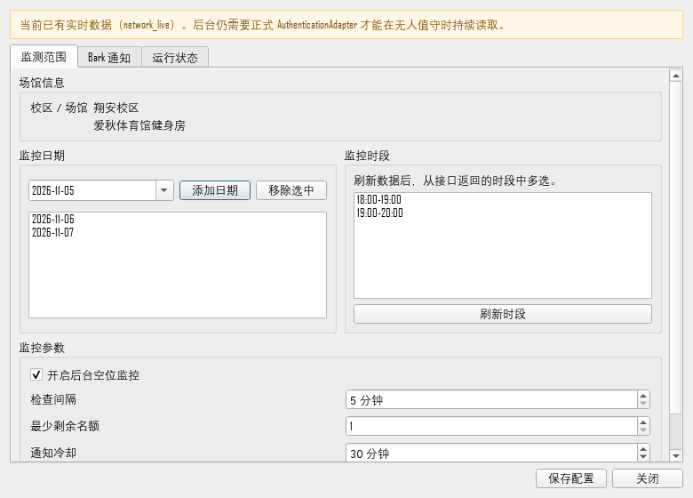

# 健身房空位监控使用指南

更新时间：2026-11-05

## 1. 功能范围

本监控只读取场馆信息，并在符合条件时发送通知：

- 只读取 Windows 微信中“厦大体育”小程序的可见页面。
- 不提交订单。
- 不处理验证码。
- 不读取、保存或重放微信 Cookie。
- 不使用缓存或模拟数据发送正式空位通知。

## 2. 配置监控

启动桌面程序：

```powershell
.\.venv\Scripts\python.exe app.py
```

界面启动后会按 `check_interval_minutes` 自动刷新，并显示“自动刷新：每 5
分钟”。“刷新数据”按钮仍可用于立即手动刷新。

点击窗口最小化或关闭按钮时，界面会隐藏到 Windows 右下角托盘，不会停止
自动刷新或后台监控。双击托盘图标可以恢复窗口；右键菜单提供“打开监控”、
“立即刷新”和“退出程序”。

点击“监控设置”：

1. 日期列表留空时监控当前可见全部日期。
2. 刷新一次场馆数据。
3. 时段列表留空时监控整个日期。
4. 设置最少剩余名额、检查间隔和通知冷却。
5. 开启“后台空位监控”。
6. 进入“Bark 通知”页填写 Bark Key。
7. 点击“发送测试通知”。
8. 点击“保存配置”。

时段完全来自当前小程序页面或缓存快照，不在代码中写死。

监控设置使用双栏和滚动区域，小屏幕不会因纵向内容过长而超出桌面。



## 3. 配置文件

非敏感配置保存在：

```text
config/monitor_config.json
```

示例：

```json
{
  "stadium_id": 16,
  "category_id": 8,
  "campus": "翔安校区",
  "stadium_name": "爱秋体育馆健身房",
  "timezone": "Asia/Shanghai",
  "check_interval_minutes": 5,
  "min_remaining": 1,
  "target_dates": [],
  "target_slots": [],
  "enabled": true,
  "notification_cooldown_minutes": 30,
  "notify_on_system_error": true,
  "system_error_cooldown_minutes": 60,
  "bark_service_url": "https://api.day.app",
  "notification_jump_url": "https://xdty.xmu.edu.cn/..."
}
```

Bark Key 不写入该文件，而是通过 `keyring` 保存到 Windows Credential
Manager。

## 4. 可用性判断

统一场次模型包含：

```text
date
venue_id
stadium_id
slot_id
start_time
end_time
capacity
selected_count
remaining
is_open
data_source
fetched_at
```

场次状态：

```text
available = is_open == true AND remaining >= min_remaining
unavailable = 已关闭或剩余不足
unknown = 开放状态或剩余名额未知
```

`unknown` 永远不会触发通知。

只有 `mini_program_live` 和旧的 `network_live` 可以触发正式通知。
`cache`、`mock` 和 `unknown` 只用于界面或测试。

日期详情页只能确认“预定 / 暂无”。日期显示“预定”时，程序会自动进入选场页，
逐日读取 `HH:MM-HH:MM`、`selected/capacity` 和开放状态；能读到具体名额时，
通知会包含日期、时间段和剩余人数。只有选场页无法解析时才退回到
“预约入口开放”，不会虚构剩余人数。

## 5. SQLite 状态

默认数据库：

```text
data/monitor_state.sqlite3
```

主要表：

### `slot_state`

保存每个实际场地的持久状态：

```text
slot_key
stadium_id
venue_id
date
slot_id
time_range
area_name
last_remaining
last_is_open
availability_state
notification_state
last_seen_at
last_data_source
last_notified_at
last_error
```

`slot_key` 包含场馆、日期、场次和场地唯一标识。多块场地分别保存。

### `notification_delivery`

记录每次推送尝试：

```text
slot_key
title
body
attempted_at
success
error_type
provider_message_id
```

### `system_alert_state`

保存认证错误、网络错误等系统异常提醒的冷却状态。

### `monitor_run`

保存每次后台运行的开始时间、结束时间、数据来源、匹配数量、通知数量、
退出码和错误信息。

## 6. 去重与冷却

- 首次读取时就发现空位，会提醒一次。
- 持续存在且没有新的状态变化，不重复提醒。
- 空位消失后再次出现，可以再次提醒。
- 每个场地的通知冷却默认为 30 分钟。
- 发送失败会在下次运行重试。
- 状态保存在 SQLite，程序重启后不会丢失。

## 7. 命令行

执行一次监控：

```powershell
.\.venv\Scripts\python.exe app.py --run-once
```

发送 Bark 测试通知：

```powershell
.\.venv\Scripts\python.exe app.py --send-test-notification
```

发送明确标记为测试的模拟空位通知：

```powershell
.\.venv\Scripts\python.exe app.py --simulate-notification
```

模拟通知不会写入正式空位状态，也不会被标记为真实空位。

## 8. 退出码

| 退出码 | 含义 |
|---:|---|
| `0` | 正常完成、无新空位、监控关闭或测试完成 |
| `2` | `AUTH_REQUIRED`，登录失效 |
| `3` | 已有另一个监控实例在运行 |
| `4` | 配置文件无效 |
| `5` | 网络、业务或解析失败 |
| `6` | Bark 未配置或通知发送失败 |

## 9. 单次任务模式

当前使用 Windows 启动文件夹拉起一个常驻守护进程，每 5 分钟执行一次只读
检查。Windows 任务计划程序脚本保留作为备用。

单实例锁保存在：

```text
data/monitor.lock
```

任务重叠时，后启动的实例会以退出码 `3` 结束。

## 10. 当前登录依赖

运行前需要：

- Windows 微信已登录；
- “厦大体育”小程序窗口保持打开；
- 小程序内部登录态有效。

程序不会导出或重放 Cookie。登录失效时：

- 不把缓存当作实时数据；
- 不发送空位通知；
- 可发送一条经过冷却的登录异常通知；
- 用户重新登录后，常驻守护进程的下一轮检查会自动恢复读取。
